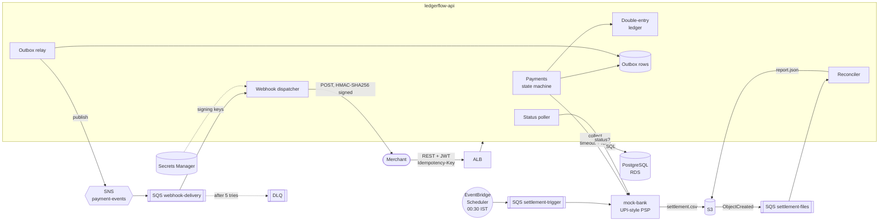
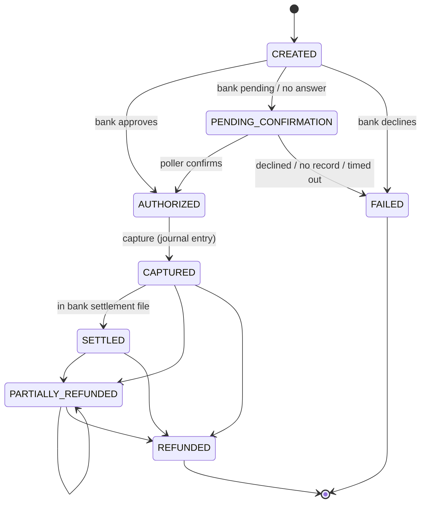

# LedgerFlow

[](https://github.com/Dishan18/LedgerFlow/actions/workflows/ci.yml)

A payments backend with a double-entry ledger, built with Java 21 and Spring Boot 4.

Merchants take payments from customers through LedgerFlow. Every money movement is a balanced,
append-only journal entry. Every POST is idempotent. Payment events reach merchants as signed
webhooks with retries and a dead-letter queue, and the ledger is reconciled every night against
the bank's settlement file. The bank is simulated by **mock-bank**, which is deliberately
unreliable: slow, sometimes down, sometimes "pending", and sometimes it loses responses.

## Architecture



Payment lifecycle:



## Run it

Prerequisite: Docker. One command starts PostgreSQL, LocalStack (SNS, SQS, S3, Secrets Manager),
mock-bank, ledgerflow-api and a demo merchant that verifies webhook signatures:

```bash
docker compose up --build
```

Then try it (the `local` profile seeds a demo merchant and 1,002 funded customers):

```bash
TOKEN=$(curl -s -X POST "localhost:8080/dev/token?merchantId=11111111-1111-1111-1111-111111111111" | python -c "import sys,json;print(json.load(sys.stdin)['access_token'])")

curl -X POST localhost:8080/v1/payments -H "Authorization: Bearer $TOKEN" \
  -H "Idempotency-Key: order-42" -H "Content-Type: application/json" \
  -d '{"customerId":"cust_alice","amount":25000}'
```

Amounts are integer **paise** (25000 = Rs 250). Swagger UI: http://localhost:8080/swagger-ui.html

For development, run only the dependencies in Docker and the apps from the IDE or Maven:

```bash
docker compose up -d postgres localstack
./mvnw -pl mock-bank -am spring-boot:run -Dspring-boot.run.profiles=local
./mvnw -pl ledgerflow-api -am spring-boot:run -Dspring-boot.run.profiles=local
python tools/merchant_receiver.py 0      # demo merchant on :9090
```

Deploying to AWS (Terraform, ECS Fargate, RDS, GitHub OIDC) and tearing it down again:
**[infra/README.md](infra/README.md)**.

## API

| Method | Path | Notes |
|---|---|---|
| POST | `/v1/payments` | Create and authorize with the bank. Needs `Idempotency-Key`. |
| GET | `/v1/payments/{id}` | |
| POST | `/v1/payments/{id}/capture` | Full capture; posts the journal entry. Needs `Idempotency-Key`. |
| POST | `/v1/payments/{id}/refunds` | Partial or full; posts a reversal entry. Needs `Idempotency-Key`. |
| GET | `/v1/reconciliation/{date}` | Latest report for an IST business date. `ops`-scoped token only. |

Errors are RFC 7807 problem documents with a stable `code` (`INSUFFICIENT_FUNDS`,
`IDEMPOTENCY_KEY_REUSED`, ...). Replayed responses carry `Idempotent-Replayed: true`.

## Results

Measured on a laptop (20 cores, everything in Docker Desktop). Reproduce with the commands in
[Reproducing the numbers](#reproducing-the-numbers).

| What | Result |
|---|---|
| **Sustained load** (k6, create + capture per payment, 2 min) | **175 payments/s = 347 req/s**, 0 errors |
| Latency at that load | create p50 **33 ms** / p99 **66 ms**; capture p50 **19 ms** / p99 **180 ms** |
| Saturation point | ~190 payments/s (Postgres commit flushes inside Docker Desktop) |
| Ledger after ~520,000 journal lines of load | **0 paise imbalance**, 0 balance drift, 0 overdrafts |
| 1,000 concurrent debits of one account funded for 500 | exactly 500 posted, **0 overdraft**, 0 deadlocks |
| 1,000 concurrent transfers in both directions across 5 accounts | **0 imbalance**, 0 deadlocks |
| Retry storms: 200 concurrent creates (1 key), 200 captures, 300 refunds | **0 duplicate charges**, refunds never exceed capture |
| 300 payments through the chaotic bank (~1 in 4 misbehaves) | 0 stuck, **0 disagreements** with the bank's records |
| Reconciliation, 40 planted discrepancies in a 292-row file | **100% caught**, 0 false alarms |
| Webhooks to a merchant failing 30% of requests | **98.9% delivered** after retries, 7 of 640 to the DLQ, 0 bad signatures |
| Tests | **65 unit**, **9 jqwik properties** (up to 1,000 generated cases each), **44 integration** (Testcontainers) |

The concurrency tests fail if the row lock is removed (all 1,000 debits "succeed" and money
disappears through lost updates), so they really test the locking.

## Design decisions and trade-offs

**Money is `long` paise, everywhere.** No floating point. Fee maths is integer basis points
with half-up rounding. Refunds return the fee proportionally using *cumulative* rounding, so a
refund in any number of pieces gives back exactly the original fee (property-tested).

**The database enforces the ledger, not just Java.** Triggers reject `UPDATE`/`DELETE`/`TRUNCATE`
on journal tables (mistakes are corrected with reversal entries), a deferred constraint trigger
rejects unbalanced entries at commit, and `CHECK (allow_negative OR balance >= 0)` blocks
overdrafts even from a psql prompt. The cached `account.balance` is checked against the journal
lines by an independent SQL audit in tests.

**Two kinds of account locking.** Accounts that must never go negative (customers) are locked with
`SELECT … FOR UPDATE` in id order (no deadlocks), checked and written. Accounts that may go negative
(merchant receivable, platform fee, bank) get an atomic `balance = balance + delta` issued last in the
transaction. Load testing found that every capture queued on the platform-fee and merchant rows
(the "hot account" problem); this cut those lock holds to the commit itself. Optimistic locking
(`@Version`) was rejected because 1,000 writers on one row turn into a retry storm.

**Never hold a database transaction across a network call.** Creating a payment is two short
transactions with the bank call between them. A crash in between leaves the payment `CREATED`, and the
status poller recovers it. Holding the transaction instead would let a slow bank exhaust the
connection pool.

**Idempotency claims the key before doing any work.** `INSERT … ON CONFLICT DO NOTHING` on the key
(namespaced per merchant) is the lock. Same body → stored response replayed; different body → 422;
still running → 409. The request hash is over the *parsed* body, so whitespace and key order don't
matter. A failed request releases its key. Once a payment row exists, create always answers with it,
so a later failure can't release the key and let a retry charge twice.

**Unknown is a real outcome.** Bank timeouts and 5xx are retried with exponential backoff and
jitter, which is only safe because the bank deduplicates by payment id. When we still don't know,
the payment becomes `PENDING_CONFIRMATION` and a poller asks the bank later, with per-payment
backoff. Pollers on several instances claim work with `FOR UPDATE SKIP LOCKED` plus a lease, never
hold a database lock while waiting on the bank, and check a batch in parallel on virtual threads.
A payment unresolved for 30 minutes is failed, and reconciliation catches it if the bank did collect.

**Transactional outbox, at-least-once delivery.** Events are written in the same transaction as
the state change, and a relay publishes them to SNS in batches of 10. A crash after publishing but
before marking the row republishes it, so consumers deduplicate by event id. Webhook retries use
the SQS message's own visibility timeout as the backoff timer (no scheduler, no retry table), and
the queue's redrive policy moves the message to the DLQ after 5 receives. Ordering across events
isn't guaranteed (standard SNS/SQS); events carry status and timestamp. A FIFO topic would fix this
at lower throughput.

**Signed webhooks like Stripe's.** `t=<timestamp>,v1=HMAC-SHA256(secret, t + "." + raw body)`, so
merchants can reject replays and must verify before parsing. Verification is constant-time.
The scheme is checked against an independent Python implementation. The signing secret comes
from Secrets Manager and is cached for 5 minutes, so a rotation takes effect without a restart.

**Reconciliation is a pure function.** The matching rules have no I/O, so a jqwik property can plant
random mixes of all four discrepancy types and assert that every one is reported, with nothing else.
Business dates are IST. A payment collected just before midnight is matched by id even if its file
is the next day's, but it shows as missing-in-bank in its own day's report.

**AWS without a NAT gateway.** Fargate tasks live in public subnets with public IPs but accept
traffic only from the load balancer; RDS lives in private subnets with no internet route. This
saves ~$35/month. The trade-off: tasks need public IPv4 addresses (~$3.6/month each), and egress
isn't centrally controlled.

**Known limits** (deliberately out of scope): HTTP only on the ALB (HTTPS needs a domain for an ACM
certificate); mock-bank keeps its state in memory; merchants are seeded rather than onboarded; local
Terraform state; single-AZ RDS.

## Testing

```bash
./mvnw verify      # unit + jqwik property tests, then Testcontainers integration tests (needs Docker)
```

Integration tests start real PostgreSQL and LocalStack containers, using the same LocalStack init
script as `docker compose`. The bank is a scriptable JDK `HttpServer` (`FakeBank`), and the
merchant is another one that verifies signatures (`MerchantReceiver`). No mocking framework, no
extra test libraries.

### Reproducing the numbers

```bash
# Load test: calm bank so k6 measures LedgerFlow, not injected chaos
BANK_MIN_DELAY=5ms BANK_MAX_DELAY=20ms BANK_ERROR_RATE=0 BANK_TIMEOUT_RATE=0 BANK_PENDING_RATE=0 \
  BANK_DECLINE_RATE=0.02 docker compose up -d --build
docker run --rm --network ledgerflow_default -v "$PWD/loadtest:/scripts" grafana/k6:2.3.0 \
  run -e BASE=http://ledgerflow-api:8080 -e RATE=175 -e DURATION=120s /scripts/payments.js

# Unreliable bank, webhooks and reconciliation: default chaos
docker compose up -d --build
python tools/chaos_run.py 300               # payments vs a misbehaving bank, then compare with its records
python tools/reconcile_run.py 10 10 10 10   # plant 40 discrepancies, score the report
```

## Project layout

```
common/            contracts shared by both services (bank API, settlement CSV, webhook signature, error codes)
ledgerflow-api/    the payments service
mock-bank/         simulated PSP/bank
infra/terraform/   AWS (VPC, ECS, RDS, SNS/SQS, S3, Scheduler, alarms, dashboard, budget, GitHub OIDC)
infra/localstack/  the same AWS resources for local runs and tests
loadtest/          k6 script
tools/             demo merchant, chaos and reconciliation runners, JWT minting (stdlib Python)
```
