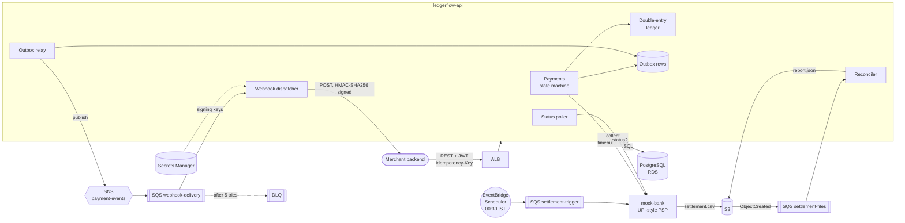
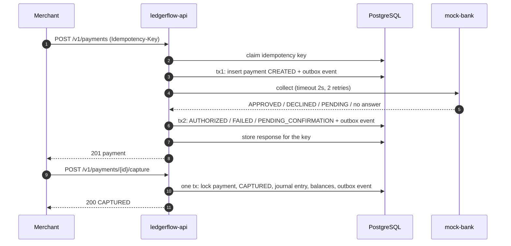
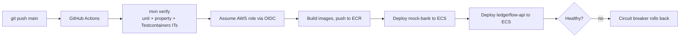

# LedgerFlow: High-Level Design

This document covers what the system does, which parts it has, how they talk to each other, and which
AWS service does what. For classes, tables, algorithms and sequences, see [LLD.md](LLD.md).

## 1. Problem

A merchant (for example a café chain) wants to take UPI-style payments from customers. The platform in
the middle must:

- **Never lose or create money.** Every rupee that moves is recorded twice (debit and credit) and the
  books always balance.
- **Never charge twice.** Mobile networks drop responses, so clients retry. A retried request must not
  create a second payment.
- **Survive an unreliable bank.** The bank is slow, sometimes down, sometimes answers "pending", and
  sometimes does the work but loses the response.
- **Tell the merchant what happened.** Each payment event goes to the merchant's server as a signed
  webhook, with retries, even if that server is down for a while.
- **Prove the books match the bank.** Every night the bank sends a settlement file; any mismatch must
  be found automatically.

## 2. Requirements

| Functional | Non-functional |
|---|---|
| Create a payment and get it authorized by the bank | Correct under concurrency: 0 imbalance, 0 overdrafts, 0 double charges |
| Capture (moves money: customer → merchant + platform fee) | Idempotent POSTs (safe client retries) |
| Full or partial refunds | Resilient to bank timeouts, 5xx and lost responses |
| Payment status lookup | At-least-once event delivery with a dead-letter queue |
| Signed webhooks for every state change | Horizontal scaling: several API instances must not step on each other |
| Daily reconciliation report (operations only) | Observable: metrics, alarms, structured logs |
| | ~175 payments/s on a laptop with p99 < 200 ms |

## 3. Architecture

### Components

| Component | What it is | Responsibility |
|---|---|---|
| **ledgerflow-api** | Spring Boot 4 service (Java 21) | REST API, payment state machine, double-entry ledger, idempotency, outbox relay, status poller, webhook dispatcher, reconciliation |
| **mock-bank** | Spring Boot service | Simulated UPI PSP/bank. Deliberately chaotic (delays, 503s, hangs, pending answers). Writes the nightly settlement CSV to S3 |
| **PostgreSQL** | RDS in AWS, container locally | Single source of truth: payments, ledger, idempotency keys, outbox, webhook deliveries, reports |
| **SNS `payment-events`** | Pub/sub topic | Fans each payment event out to subscribers (today: the webhook queue; tomorrow: analytics, fraud) |
| **SQS queues** | Work queues + DLQs | Buffer webhook deliveries and settlement files, give free retries and dead-lettering |
| **S3 bucket** | Object storage | Settlement files from the bank (`settlements/<date>/settlement.csv`) and reconciliation reports (`reports/<date>.json`) |
| **Merchant receiver** | Python, demo only | Plays the merchant: verifies webhook signatures and fails 10–30% of requests on purpose |

## 4. Main flows

### 4.1 Take a payment

### 4.2 Events to webhooks

1. Every state change writes an **outbox row in the same transaction** as the change.
2. The **outbox relay** (every 500 ms) publishes unpublished rows to SNS in batches of 10.
3. SNS pushes each event into the **`webhook-delivery`** SQS queue (raw delivery).
4. The **webhook dispatcher** consumes it, signs the body with HMAC-SHA256 and POSTs it to the
   merchant's URL.
5. On failure the message's visibility timeout is set to the backoff (10 s, 20 s, 40 s, … up to 5 min),
   so SQS itself redelivers later. After 5 receives SQS moves it to the **DLQ** and an alarm fires.

### 4.3 Nightly reconciliation

1. **EventBridge Scheduler** fires at 00:30 IST and drops a message on `settlement-trigger`.
2. **mock-bank** writes yesterday's settlement CSV to S3.
3. S3 sends an **ObjectCreated** notification to the `settlement-files` queue.
4. **ledgerflow-api** reads the file, matches it against the ledger, stores the report in Postgres,
   copies it to S3, marks matched payments `SETTLED` and emits `payment.settled` events.
5. Operations staff read it at `GET /v1/reconciliation/{date}` (token needs the `ops` scope).

## 5. Where AWS is used, and why

The whole stack is defined in Terraform (`infra/terraform`). Locally, **LocalStack** creates the same
SNS/SQS/S3/Secrets Manager resources (`infra/localstack/init-aws.sh`), so the application code is
identical in both places; only endpoints and names change through environment variables.

| AWS service | Used for | Why this service | Where in code |
|---|---|---|---|
| **ECS Fargate** | Runs `ledgerflow-api` and `mock-bank` containers | No servers to patch; pay per task; rolling deploys with circuit-breaker rollback | `infra/terraform/ecs.tf` |
| **Application Load Balancer** | Public HTTP entry, health checks on `/actuator/health` | Spreads traffic over API tasks; only route from the internet to the API | `ecs.tf` |
| **RDS PostgreSQL** (db.t4g.micro) | Payments, ledger, outbox, idempotency, reports | Ledger needs ACID transactions, row locks, `SKIP LOCKED`, triggers and CHECK constraints | `data.tf` |
| **SNS** `payment-events` | Publishes every payment event | Fan-out: add new consumers without touching the producer | `OutboxRelay.java`, `messaging.tf` |
| **SQS** `webhook-delivery` + DLQ | Webhook work queue | Durable buffer; visibility timeout = free retry timer; redrive to DLQ after 5 tries | `WebhookListener.java` |
| **SQS** `settlement-trigger` | Tells mock-bank to produce the daily file | Decouples the schedule from the bank service | `SettlementTriggerListener.java` |
| **SQS** `settlement-files` + DLQ | S3 "file arrived" notifications | Reconciliation runs exactly when the file lands; bad files go to the DLQ | `SettlementFileListener.java` |
| **S3** | Settlement CSVs and report JSONs | Cheap, durable file storage with event notifications; 90-day lifecycle, encrypted, private | `ReconciliationService.java`, `S3SettlementStore.java` |
| **EventBridge Scheduler** | 00:30 IST daily trigger | Managed cron with time-zone support; no always-on scheduler | `messaging.tf` |
| **Secrets Manager** | JWT key, webhook signing key, RDS password (RDS-managed) | Secrets never live in code, images or Terraform variables; rotation without redeploy (5-min cache) | `WebhookSigningKeyProvider.java`, `data.tf` |
| **ECR** | Docker images for both services | Private registry next to ECS; lifecycle policy keeps the last images | `data.tf` |
| **CloudWatch** | Logs, Micrometer metrics (namespace `LedgerFlow`), alarms, dashboard | One place for logs, app metrics and AWS metrics | `observability.tf`, `dashboard.tf` |
| **Cloud Map** | `mock-bank.ledgerflow.local` DNS name | API finds the bank inside the VPC without a second load balancer | `ecs.tf` |
| **IAM + GitHub OIDC** | Least-privilege task roles; deploy role for GitHub Actions | No long-lived AWS keys stored in GitHub | `github_oidc.tf`, `ecs.tf` |
| **AWS Budgets** | Email at 50% / 80% / 100% forecast of the monthly budget | Cost guard for a personal account | `observability.tf` |
| **VPC** | Public subnets (ALB, tasks), private subnets (RDS) | RDS has no internet route; tasks accept traffic only from the ALB. No NAT gateway (saves ~$35/month) | `network.tf` |

**Deployment status:** the infrastructure is fully written and passes `terraform validate`, and the
CI pipeline has a deploy job ready. It isn't kept running, because the always-on pieces (ALB, RDS,
Fargate, public IPv4) cost about $70–80/month. `terraform apply` brings it up and `terraform destroy`
removes it.

## 6. Deployment and CI/CD

- Pull requests run the build and tests only.
- The deploy job runs only on `main`, and only when the `AWS_DEPLOY_ROLE_ARN` repository variable exists.
- `wait-for-service-stability` makes the pipeline fail if the new tasks don't become healthy.

## 7. Key design decisions (short form)

| Decision | Alternative rejected | Reason |
|---|---|---|
| Money as `long` paise | `double`, `BigDecimal` | No rounding drift; fast; fits ₹1 crore × 10,000 bps without overflow |
| Ledger rules enforced in the database too | Java-only checks | A bug or a manual `psql` session still can't unbalance or overdraw |
| Pessimistic lock for customers, atomic increment for hot accounts | Optimistic `@Version` everywhere | 1,000 writers on one row would turn into a retry storm |
| Two transactions around the bank call | One long transaction | A slow bank would hold connections and locks and exhaust the pool |
| Transactional outbox | Publish to SNS inside the request | No "DB committed but event lost" or "event sent but DB rolled back" |
| SQS visibility timeout as retry timer | Retry table + scheduler | Less code; SQS gives durability and DLQ for free |
| `FOR UPDATE SKIP LOCKED` for pollers | Leader election / distributed lock | Any number of instances can share the work with no coordinator |
| Reconciliation as a pure function | Logic mixed with I/O | Property-testable: random planted mistakes must all be found |

## 8. Scaling path

| Load | What to change |
|---|---|
| Today (~175 payments/s on a laptop) | 1 API task, 1 small Postgres |
| ~1,000/s | More API tasks behind the ALB (stateless; pollers and relay already share work through `SKIP LOCKED`); bigger RDS; PgBouncer/RDS Proxy for connections |
| ~5,000/s | Read replica for GETs and reports; partition `journal_line` and `outbox_event` by month; split the fee account into N sub-accounts to spread the hot row |
| Beyond | Shard by merchant (each shard its own Postgres); move outbox to CDC (Debezium → Kafka); SNS FIFO or Kafka where per-payment ordering matters |
