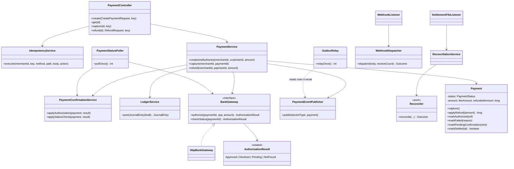
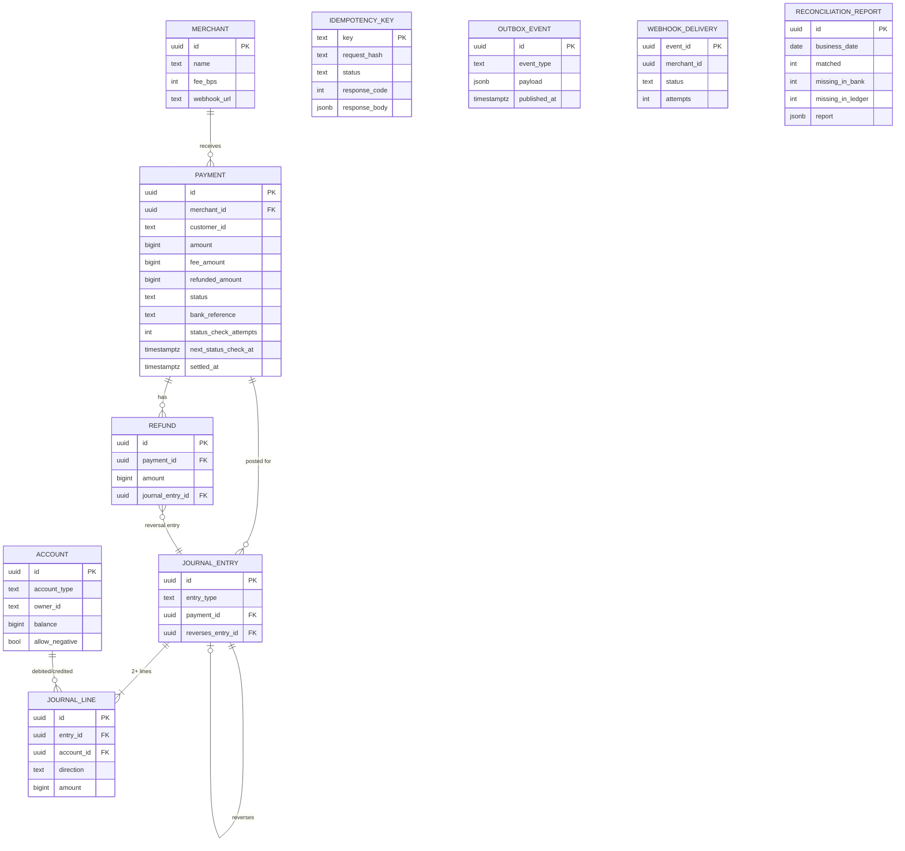
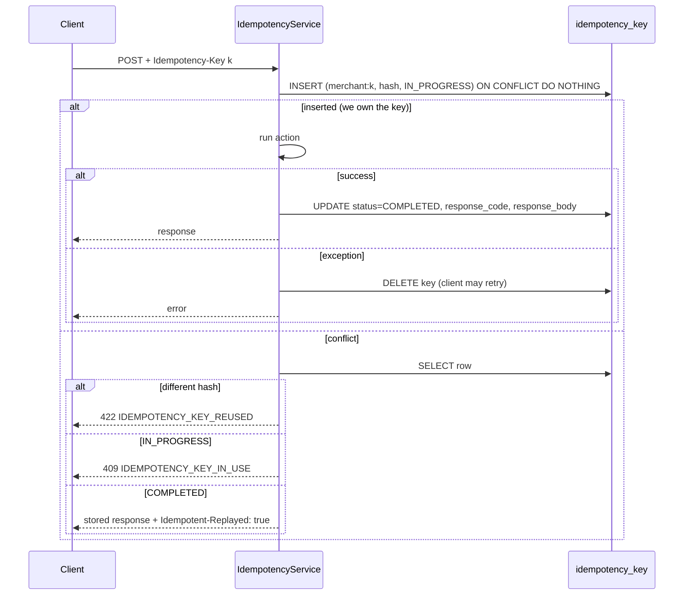

# LedgerFlow: Low-Level Design

Classes, tables, algorithms and sequences. For the big picture and the AWS mapping, see [HLD.md](HLD.md).

## 1. Modules and packages

```
common/                         shared contracts, no Spring
  bank/        BankApi (paths), CollectRequest, CollectResponse, CollectStatus
  settlement/  SettlementCsv (format, parse, write, business date = IST)
  webhook/     WebhookSignature (sign / verify, header names)
  error/       ErrorCode (stable API error codes)

ledgerflow-api/  com.ledgerflow.api
  web/             PaymentController, GlobalExceptionHandler (RFC 7807), DTOs
  idempotency/     IdempotencyService, IdempotencyRepository, RequestHasher, cleanup job
  payment/         Payment (entity + state machine), PaymentStatus, PaymentService,
                   PaymentConfirmationService, PaymentStatusPoller(+Job), FeeCalculator, Refund
  ledger/          LedgerService, Account, AccountType, JournalEntry, JournalLine, JournalEntryDraft
  bank/            BankGateway (interface), HttpBankGateway, AuthorizationResult (sealed)
  outbox/          PaymentEventPublisher, OutboxRelay(+Job), OutboxEvent
  webhook/         WebhookListener (SQS), WebhookDispatcher, WebhookSigningKeyProvider
  reconciliation/  Reconciler (pure), ReconciliationService, SettlementFileListener (SQS), controller
  merchant/        Merchant, MerchantRepository
  config/          SecurityConfig (JWT), DevTokenController (local only), Clock, OpenAPI
  support/         AssignedIdEntity (Persistable for pre-assigned UUIDs)

mock-bank/       com.ledgerflow.mockbank
  CollectController, CollectService, ScenarioPicker, Scenario, ChaosProperties
  settlement/      SettlementGenerator, SettlementController, SettlementTriggerListener (SQS),
                   S3SettlementStore, Discrepancies
```

## 2. Class diagram (core)



## 3. Data model

All money columns are `BIGINT` paise. Flyway migrations: `V1` core, `V2` bank confirmation,
`V3` webhooks, `V4` reconciliation (`ledgerflow-api/src/main/resources/db/migration`).



### Constraints the database enforces by itself

| Rule | How |
|---|---|
| Journal is append-only | `BEFORE UPDATE OR DELETE` and `BEFORE TRUNCATE` triggers on `journal_entry` and `journal_line` raise an exception |
| Every entry balances | `CONSTRAINT TRIGGER … DEFERRABLE INITIALLY DEFERRED`: at COMMIT, each touched entry needs ≥ 2 lines and debits = credits |
| No overdraft | `CHECK (allow_negative OR balance >= 0)` on `account` |
| Fee ≤ amount, refunds ≤ amount | `CHECK` constraints on `payment` |
| One account per (type, owner) | `UNIQUE (account_type, owner_id)` |
| Idempotency | `idempotency_key.key` primary key, value `merchantId:clientKey` |
| Webhook consumer dedup | `webhook_delivery.event_id` primary key |

### Partial indexes for the background jobs

- `outbox_event (created_at) WHERE published_at IS NULL`: the relay only scans unpublished rows.
- `payment (next_status_check_at) WHERE status IN ('CREATED','PENDING_CONFIRMATION')`: the poller only
  scans payments still waiting on the bank.

## 4. Accounts and journal entries

| Account type | Normal side | May go negative | Owner |
|---|---|---|---|
| `CUSTOMER` | Credit | **No** (guarded) | customer id |
| `MERCHANT_RECEIVABLE` | Credit | Yes | merchant id |
| `PLATFORM_FEE` | Credit | Yes | `SYSTEM` |
| `BANK_SETTLEMENT` | Debit | Yes | `SYSTEM` |

Worked example: ₹250 payment (25,000 paise), merchant fee 200 bps (2%) → fee 500.

| Entry | Account | Debit | Credit |
|---|---|---|---|
| **Capture** | Customer | 25,000 | |
| | Merchant receivable | | 24,500 |
| | Platform fee | | 500 |
| **Refund ₹100** (10,000) | Merchant receivable | 9,800 | |
| | Platform fee | 200 | |
| | Customer | | 10,000 |

The refund's fee share uses **cumulative rounding**:
`feeBack = round(fee × (alreadyRefunded + refund) / amount) − round(fee × alreadyRefunded / amount)`,
so any sequence of partial refunds returns exactly the original fee (jqwik property `RefundLimitProperties`).

## 5. `LedgerService.post` algorithm

```
post(draft):                                   # must run inside the caller's transaction
  ids     = sorted set of account ids in draft
  rules   = SELECT id, account_type, allow_negative FROM account WHERE id IN ids   # no lock
  guarded = ids where NOT allow_negative       # customers

  1. SELECT ... FROM account WHERE id IN guarded ORDER BY id FOR UPDATE
     apply each line in Java; throws InsufficientFundsException if balance < 0
  2. INSERT journal_entry + journal_lines; flush
  3. for each unguarded id, in id order:
        UPDATE account SET balance = balance + :delta WHERE id = :id   # atomic, no read
COMMIT → deferred trigger checks balance of every entry
```

- **Deadlock-free:** every transaction locks rows in the same global order (guarded by id, then
  unguarded by id).
- **Hot accounts:** every capture touches `PLATFORM_FEE` and the merchant's receivable. Updating them last,
  with no prior read, means their row locks are held only from step 3 until COMMIT. Load testing showed
  this was the main throughput limit before the change.

## 6. Payment state machine

| From | Allowed to |
|---|---|
| `CREATED` | `AUTHORIZED`, `PENDING_CONFIRMATION`, `FAILED` |
| `PENDING_CONFIRMATION` | `AUTHORIZED`, `FAILED` |
| `AUTHORIZED` | `CAPTURED` |
| `CAPTURED` | `SETTLED`, `PARTIALLY_REFUNDED`, `REFUNDED` |
| `SETTLED` | `PARTIALLY_REFUNDED`, `REFUNDED` |
| `PARTIALLY_REFUNDED` | `PARTIALLY_REFUNDED`, `REFUNDED` |
| `FAILED`, `REFUNDED` | (terminal) |

Every change goes through `Payment.transitionTo`, which throws `IllegalStateTransitionException` (HTTP 409)
for anything else. A jqwik property (`StateTransitionProperties`) drives random sequences of operations
and checks the table holds.

## 7. Idempotency



- Request hash = SHA-256 of method + path + the **re-serialized parsed body**, so whitespace and key
  order don't change it.
- Keys expire after 24 h (`IdempotencyCleanupJob`, hourly).
- Once a payment row is committed, `createAndAuthorize` always returns it (even if recording the bank
  answer fails), so the key is never released after money might have moved.

## 8. Talking to the unreliable bank

`HttpBankGateway`:

| Setting | Value |
|---|---|
| Connect / read timeout | 1 s / 2 s |
| Retries (authorize only) | 2, exponential 200 ms → 1 s, with jitter |
| Retried on | I/O errors (timeouts, refused) and 5xx |
| Not retried | 4xx → `Declined("BANK_REJECTED_4xx")` |
| Still no answer | `Pending("BANK_UNREACHABLE")` → payment goes to `PENDING_CONFIRMATION` |

Retrying is safe because mock-bank deduplicates collects by payment id (a retry returns the stored
answer instead of charging again).

**Status poller** (`PaymentStatusPoller`, every 5 s, batch 50):

```sql
UPDATE payment SET next_status_check_at = :now + lease(1 min)
 WHERE id IN (SELECT id FROM payment
               WHERE status IN ('CREATED','PENDING_CONFIRMATION')
                 AND next_status_check_at <= :now
               ORDER BY next_status_check_at LIMIT 50
               FOR UPDATE SKIP LOCKED)
RETURNING id;
```

- The claim is one auto-committed statement, so no database lock is held while calling the bank.
- A batch is checked in parallel on **virtual threads**; each result is recorded in its own short
  transaction under the payment's row lock.
- Backoff per payment: 5 s × 2^attempts, capped at 5 min.
- Bank says `NotFound` after a 2-minute grace → `FAILED (BANK_HAS_NO_RECORD)`.
- Still pending after 30 minutes → `FAILED (CONFIRMATION_TIMEOUT)`; if the bank did collect,
  reconciliation reports it as missing-in-ledger.
- If an instance dies mid-check, the lease expires and another instance takes over.
- The job keeps draining while batches come back full.

**mock-bank scenarios** (random by rate, or forced by a `+tag` in the payer VPA such as `cust_1+timeout`):

| Scenario | Default rate | Behaviour |
|---|---|---|
| `APPROVE` | rest | 20–300 ms delay, approved |
| `DECLINE` | 5% | declined |
| `PENDING` / `PENDING_DECLINE` | 10% (80/20 split) | "pending", resolved after 15 s |
| `TIMEOUT` | 5% | approves, then hangs 10 s on the first response (lost response) |
| `ERROR` | 5% | 503, nothing recorded |
| `FLAKY` | tag only | 503 on the first try, then approved |

## 9. Outbox and webhooks

**Event payload** (`PaymentEventPublisher.PaymentEvent`):
`eventId, eventType, paymentId, merchantId, amount, refundedAmount, currency, status, occurredAt`.
Event types: `payment.created`, `payment.authorized`, `payment.pending_confirmation`, `payment.failed`,
`payment.captured`, `payment.refunded`, `payment.settled`.

**Relay** (`OutboxRelay`, every 500 ms, batch 100): `SELECT … WHERE published_at IS NULL ORDER BY created_at
LIMIT 100 FOR UPDATE SKIP LOCKED`, then `PublishBatch` to SNS 10 at a time, then mark the accepted ones
published. A crash in between republishes (at least once).

**Dispatcher** (`WebhookListener` → `WebhookDispatcher`, up to 10 concurrent):

```
dispatch(body, receiveCount):
  row = findOrCreate webhook_delivery(event_id)
  if row.status != PENDING           → done (duplicate from SNS/SQS/relay)
  if merchant has no webhook_url     → SKIPPED
  POST url with headers:
     X-LedgerFlow-Signature: t=<unix>,v1=hex(HMAC_SHA256(secret, t + "." + body))
     X-LedgerFlow-Event-Id, X-LedgerFlow-Event-Type
  2xx                                → DELIVERED, delete message
  failure, receiveCount < 5          → visibility = 10s × 2^(n-1) (max 5 min), keep message
  failure, receiveCount = 5          → DEAD_LETTERED; SQS moves it to the DLQ on next receive
```

Retry timeline: attempt 1 → +10 s → 2 → +20 s → 3 → +40 s → 4 → +80 s → 5 → DLQ.
The signing secret comes from Secrets Manager and is cached for 5 minutes.

## 10. Reconciliation

CSV header: `settlement_date,utr,payment_id,payer_vpa,amount_paise`. File key
`settlements/<yyyy-mm-dd>/settlement.csv`.

| Case | Classified as |
|---|---|
| Payment id appears more than once in the file | `DUPLICATE` (and still matched once) |
| Bank row, but LedgerFlow doesn't consider it collected (unknown, failed, pending) | `MISSING_IN_LEDGER` |
| Both sides, different amount | `AMOUNT_MISMATCH` |
| LedgerFlow collected it that IST day, not in the file | `MISSING_IN_BANK` |
| Otherwise | matched → `SETTLED`, `payment.settled` event |

"Collected" means the payment has a bank reference and isn't `FAILED` or still waiting on the bank.
`Reconciler` does no I/O; `ReconciliationService` loads data, calls it, stores the report (Postgres +
`reports/<date>.json` in S3) and settles matched payments. Failures go back to SQS and, after 3 tries,
to `settlement-files-dlq`.

## 11. API surface

| Method | Path | Success | Errors |
|---|---|---|---|
| POST | `/v1/payments` | 201 | 400 `MISSING_IDEMPOTENCY_KEY`/`VALIDATION_FAILED`, 422 `CUSTOMER_ACCOUNT_NOT_FOUND`, 409/422 idempotency |
| GET | `/v1/payments/{id}` | 200 | 404 `PAYMENT_NOT_FOUND` (also for other merchants' payments) |
| POST | `/v1/payments/{id}/capture` | 200 | 409 `INVALID_STATE_TRANSITION`, 422 `INSUFFICIENT_FUNDS` |
| POST | `/v1/payments/{id}/refunds` | 201 | 422 `REFUND_EXCEEDS_CAPTURED`, 409 `INVALID_STATE_TRANSITION` |
| GET | `/v1/reconciliation/{date}` | 200 | 403 without `ops` scope |
| POST | `/dev/token` | 200 | local profile only |

Auth: HS256 JWT; `sub` = merchant id; `scope=ops` for operations. Errors are RFC 7807 problem JSON
with a stable `code`.

mock-bank: `POST /bank/v1/collects`, `GET /bank/v1/collects/{paymentId}`,
`POST /bank/v1/settlements/{date}?drop=&duplicate=&wrongAmount=&phantom=` (on-demand file with planted
mistakes).

## 12. Testing strategy

| Layer | Examples | Tool |
|---|---|---|
| Unit (65) | `FeeCalculatorTest`, `RequestHasherTest`, `WebhookSignatureTest`, `HttpBankGatewayTest`, `ReconcilerTest` | JUnit 6, AssertJ |
| Property (9) | `LedgerBalanceProperties`, `RefundLimitProperties`, `StateTransitionProperties`, `ReconcilerProperties` | jqwik, up to 1,000 cases each |
| Integration (44) | `ConcurrentTransfersIT`, `RetryStormIT`, `IdempotencyIT`, `UnreliableBankIT`, `WebhookDeliveryIT`, `ReconciliationIT`, `LedgerInvariantsIT`, `PaymentFlowIT` | Testcontainers (Postgres 17, LocalStack 4.14), `FakeBank`, `MerchantReceiver` |
| System | `tools/chaos_run.py`, `tools/reconcile_run.py`, `loadtest/payments.js` | Python stdlib, k6 |

Every integration test ends with an independent SQL audit: global imbalance = 0, no account whose cached
balance differs from the sum of its lines, no overdrawn guarded account.
